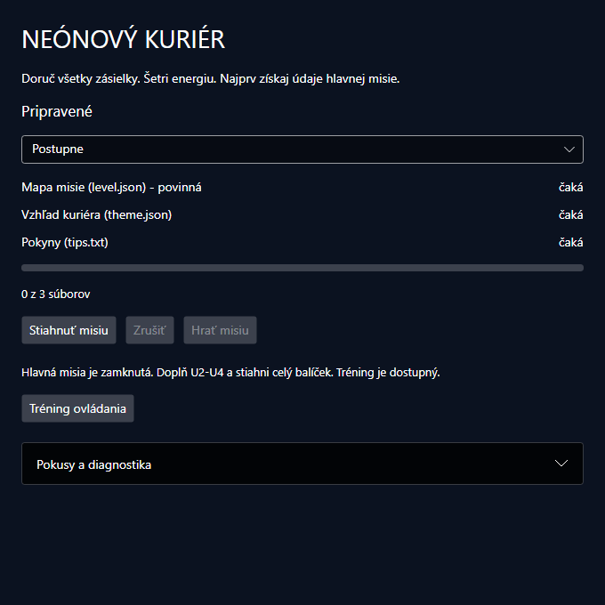
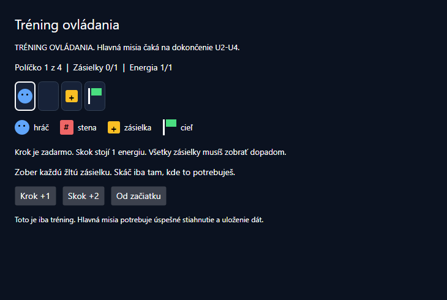
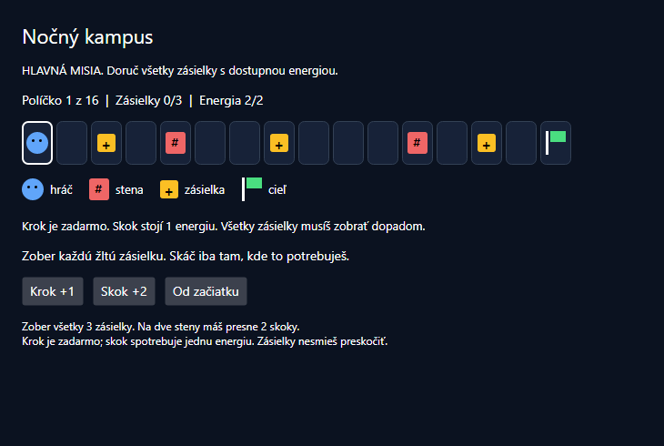
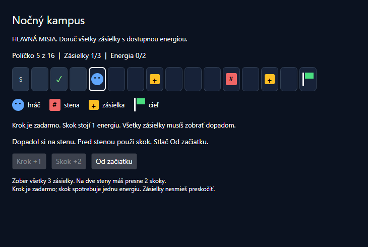
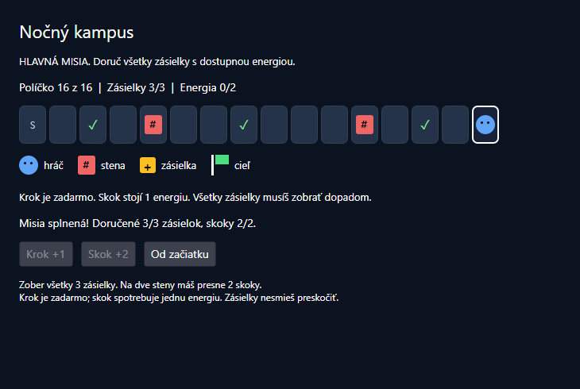

# Laboratórne cvičenie 4

Neónový kuriér a asynchrónne programovanie

Pokročilé objektové technológie

**100 minút**

Si kuriér v nočnom meste. Musíš vyzdvihnúť všetky zásielky a doručiť ich na druhý koniec trasy. Skok spotrebuje energiu, preto nestačí stále skákať. Údaje hlavnej misie sú však na serveri a aplikácia ich zatiaľ nevie získať. Doplň službu, zrýchli sťahovanie, zvládni výpadok a sprístupni vlastnú misiu.

Na začiatku si vyskúšate iba **krátky tréning ovládania**. Hlavná misia sa sprístupní až po úspešnom stiahnutí a uložení balíčka v U2-U4. V U6 použijete lokálnu kópiu pri výpadku voliteľného vzhľadu. V U7 obmedzíte počet rozpracovaných prenosov. Počas čakania musia obe okná reagovať.

Okná a herné pravidlá sú hotové. **Dopĺňate iba Core/DownloadService.cs** a vlastné testy. Lokálny HTTP server sa spustí automaticky. Oneskorenie simuluje pomalú sieť; HTTP aj zápis na disk sú skutočné. Nepotrebujete internetové API ani kľúč. Aplikácia používa Avalonia pre Windows a macOS.

## Čo si precvičíte

- Task oproti výsledku a pozastavenie metódy pri await.
- Asynchrónne HTTP a súbory, priebeh START, DONE a CACHE.
- Postupné a súbežné operácie cez Task.WhenAll.
- Výnimky, spolupracujúce zrušenie a obnovu ovládania vo finally.
- Cache, limit cez SemaphoreSlim a testy, ktoré odhalia nesprávne správanie.

| Minúty | Blok | Viditeľný výsledok |
| --- | --- | --- |
| 0-8 | Štart a tréning | Hlavná misia zostáva zamknutá |
| 8-18 | U1 Odozva a await | Obe okná reagujú počas čakania |
| 18-30 | U2 Mapa misie | Získate JSON cez HTTP |
| 30-47 | U3 Súbeh | Približne 2,8 s oproti 1,2 s |
| 47-58 | U4 Uloženie a vlastná misia | Odomknete skutočnú hru |
| 58-70 | U5 Výpadok a zrušenie | Rozumiete chybovým stavom |
| 70-85 | U6 Cache a vlastné testy | Výpadok vzhľadu nezastaví novú misiu |
| 85-97 | U7 Riadený súbeh | Najviac dva prenosy naraz |
| 97-100 | Kontrola | Vysvetlíte návrh a jeho hranice |

**Pracujte vlastným tempom. Riešenie ani odpovede neodovzdávate.** ChatGPT, Antigravity, Claude Code, GitHub Copilot alebo iného asistenta môžete používať na návrh, kód aj testy. Pred pokusom predpovedzte priebeh, prezrite diff, spustite kontrolu a vysvetlite výsledok. Samotné doplnenie syntaxe môže byť s AI oveľa kratšie než cvičenie.

<!-- page -->

# Spustite projekt a vyskúšajte tréning

**0-8 minút**

Rozbaľte **POT_Lab04_Starter_NET10.zip** a otvorte **NeonovyKurier.slnx**. Potrebujete .NET 10 SDK. Na Windows môžete použiť Visual Studio 2026, na macOS Rider alebo VS Code s podporou C#. Prvý restore potrebuje internet alebo NuGet cache; pripravte ho pred hodinou.

Príkazy spúšťajte v priečinku s NeonovyKurier.slnx. Vo Visual Studiu nastavte **NeonovyKurier.Desktop** ako startup project a použite Ctrl+F5. V termináli:

```text
dotnet build NeonovyKurier.slnx
dotnet run --project NeonovyKurier.Desktop
```

**Očakávaný starter:** build prejde, ale pri `dotnet test NeonovyKurier.slnx` prechádza iba **5 z 18** testov. Zvyšných 13 zatiaľ zlyháva na nedoplnených metódach. Dodané testy nemeňte.

Kliknite **Tréning ovládania**. Krátku trasu S.*G prejdete tromi krokmi alebo skokom a krokom. Tréning iba ukáže ovládanie. Jeho dokončenie hlavnú misiu neodomkne. Tlačidlo **Hrať misiu** zostáva vypnuté; **Stiahnuť misiu** zatiaľ oznámi nedoplnenú U3a. Je to správny východiskový stav.

**Po každej úprave kódu aplikáciu zatvorte a spustite znovu.** Zatvorenie samotnej hry hlavné okno nezatvorí. Obe okná používajú jedno UI vlákno.

## Ktoré súbory potrebujete

| Súbor | Úloha pri učení |
| --- | --- |
| Core/Models.cs | GameAsset, DownloadResult a DownloadProgress |
| Core/DownloadService.cs | Vaše TODO pre U2-U7 |
| Desktop/MainWindow.cs | Pripravené volanie služby a tokeny, čítate v U5 |
| Cli/MissionContent.cs a Content | Zoznam súborov a dáta misie |
| Tests/DownloadTests.cs | Dodaných 18 kontrol, nemeníte ich |
| Tests/OwnFeatureTests.cs | Vaše tri testy U6 |
| Tests/LimitedConcurrencyTests.cs | Váš povinný test U7 |

Core, Desktop, Cli a Tests sú skratky projektov NeonovyKurier.Core atď. Mission.cs a MissionPackage.cs sú pripravené pravidlá a načítanie dát, nie ďalšie TODO. Pomocné tlačidlá sú v **Pokusy a diagnostika**. Herné dáta sú v **NeonovyKurier.Cli/Content**.

## AI ako spolupracovník

Priložte **AI_KONTEXT.md**, aktuálnu metódu a jej kontrakt. Pre Copilot je pripravený aj **.github/copilot-instructions.md**. Postačí textový chat. Riešte jednu úlohu naraz a overte, čo asistent skutočne spustil.

**Prvý prompt:** „Prečítaj Models.cs a DownloadService.cs. Vysvetli rozdiel GameAsset, Task<DownloadResult> a DownloadResult na získaní mapy. Zatiaľ nič neupravuj. Herné pravidlá, okná aj server sú pripravené.“

<!-- page -->

# Orientácia v pripravených oknách





Screenshoty ukazujú skutočné ovládanie. Systémový rám a písmo sa môžu medzi počítačmi líšiť. Obe okná zostávajú pripravené počas celého cvičenia.

<!-- page -->

# Ako sa hrá hlavná misia

**Cieľ:** kuriér musí zobrať všetky žlté zásielky a doručiť ich k zelenej vlajke. Pohyb ide iba doprava, čas vás nenaháňa. Pred pohybom sa pozrite na trasu a zostávajúcu energiu.

- **Krok +1** posunie o jedno políčko a nespotrebuje energiu.
- **Skok +2** preskočí jedno políčko, dopadne na ďalšie a spotrebuje jednu energiu.
- **Stena #** ukončí pokus pri dopade. Preskočíte ju, keď stojíte tesne pred ňou.
- **Žltá zásielka je povinná.** V mape má znak hviezdičky. Získate ju dopadom na jej políčko. Jej preskočenie ukončí pokus, pretože sa už nemôžete vrátiť.
- **Nedostatok energie** na ďalší skok ukončí pokus. Zbytočný skok môže znemožniť prechod neskoršej steny.
- **Od začiatku** obnoví pozíciu, zásielky aj energiu.

Predvolená hlavná misia má **3 zásielky a 2 energie na 2 steny**. Opakované skákanie nestačí: druhý skok dopadne na stenu. Začnite **Krok, Krok, Krok, Skok**. Po dvoch krokoch zoberiete prvú zásielku, štvrtým pohybom preskočíte stenu. Zvyšok najprv naplánujte.



**Mapa level.json** obsahuje name, track a jumpBudget. S je štart, bodka voľné miesto, # stena, * zásielka a G cieľ. **theme.json** určuje označenie kuriéra, **tips.txt** pokyny. Po U4 hra číta skutočne stiahnuté a uložené súbory. Predtým dostupný tréning používa samostatné štyri políčka v kóde.

Úspešné uloženie a validáciu potvrdí pripravená aplikácia súborom .mission-ready. Samotná mapa v pamäti ani nedokončený zápis hlavnú misiu neodomkne. Toto potvrdenie ani herný kód neimplementujete.

<!-- page -->

# U1 Prečo okno počas čakania reaguje

**8-18 minút • pripravený pokus v okne**

Nechajte tréning otvorený, stlačte Od začiatku a v aplikácii rozbaľte **Pokusy a diagnostika**. Predpovedzte, či sa počas čakania zvýši počítadlo **UI žije**, zareaguje **Skúsiť odozvu +1** a posunie sa hráč. Potom porovnajte dva krátke pokusy:

1. Stlačte **Sleep 1,5 s** a skúste tréning alebo odozvu. UI vlákno čaká v Thread.Sleep a obe okná sa na chvíľu zastavia.
2. Stlačte **Await 1,5 s** a urobte to isté. Pri nedokončenom Task.Delay sa metóda pozastaví a UI môže spracovať kliknutie.
3. Po pokuse Await si v poli **Časová stopa** pozrite ID vlákna a SynchronizationContext pred a po await. Uvidíte AvaloniaSynchronizationContext a rovnaké ID: pokračovanie sa vrátilo do UI vlákna. Async samo nevytvára nové vlákno.

Thread.Sleep je tu iba zámerná chyba na krátke porovnanie. Bežné sťahovanie ani zápis ho nepoužívajú. Task.Delay modeluje čakanie; v U2 začne skutočné HTTP.

## Kedy volajúci dostane Task

V **Cli/TraceExperiment.cs** prečítajte RunAsync a ReadAsync. Predpovedzte poradie A, B, C, D, E a overte ho:

```text
dotnet run --project NeonovyKurier.Cli -- --trace
```

Pri Delay 500 je poradie **A, B, C, D, E**. ReadAsync sa začne hneď. Pri nedokončenom await sa pozastaví a volajúci dostane Task. Ten sa dokončí až po vykonaní D a návrate hodnoty. Cez await volajúci získa reťazec a vykoná E.

**Ak zostáva čas:** dajte breakpoint na await a D, sledujte návrat k C a work.IsCompleted. Zmeňte Delay 500 na **Delay 0**. Očakávajte **A, B, D, C, E** a dokončený Task; potom vráťte 500. Await už dokončenej operácie nemusí metódu pozastaviť.

## Súvis s prednáškou

Kompilátor vytvorí stavový automat, ktorý uchová stav na pokračovanie za await. Obe okná zdieľajú UI vlákno; samostatné okno nevytvára vlastné vlákno. UI kontext umožní pokračovať pri ovládacích prvkoch. V bežnej konzole je SynchronizationContext null. Blokovanie UI cez .Result alebo .Wait môže spôsobiť aj uviaznutie; taký pokus tu nespúšťame.

**ConfigureAwait(false) negarantuje nové vlákno.** Pri danom await nežiada návrat do zachyteného kontextu. Dokončený Task v trace ukazuje aj rovnaké ID pred a po. Do UI obsluhy ho nepridávajte pred priamu zmenu ovládacích prvkov.

**Prompt:** „Vysvetli rozdiel Sleep a await v pripravenom okne a poradie trace pri Delay 500 a 0. Rozlíš pozastavenie metódy od blokovania vlákna. Kód zatiaľ nemeň.“

Podklady: [Avalonia threading](https://docs.avaloniaui.net/docs/app-development/threading) a [ConfigureAwait FAQ](https://devblogs.microsoft.com/dotnet/configureawait-faq/).

<!-- page -->

# U2 Stiahnite mapu misie

**18-30 minút • Core/DownloadService.cs • DownloadAssetAsync**

Po úprave každej metódy zatvorte aplikáciu, spustite jej testy a znovu spustite Desktop.

Nájdite **BEGIN U2** a **END U2**. Ponechajte pripravené kontroly a hlásenie START. Do deklarácie metódy pridajte **async**, návratový typ nechajte `Task<DownloadResult>`. Nahraďte TODO a NotImplementedException.

## Kontrakt

- Cez existujúci `_client.GetStringAsync(asset.Route, cancellationToken)` a await získajte celý text.
- Po úspešnom získaní obsahu oznámte `_progress?.Report(new(asset.Id, "DONE"));`.
- Vráťte `new DownloadResult(asset, content)`. HTTP chybu a zrušenie zatiaľ nezachytávajte.

**Pozor na rady kompilátora:** ak použijete await a zabudnete pridať async, zobrazí sa chyba CS4032 s návrhom zmeniť návratový typ na `Task<Task<DownloadResult>>`. Tento návrh neprijímajte. Stačí pridať async a typ `Task<DownloadResult>` ponechať.

GameAsset opisuje súbor. Task predstavuje prebiehajúcu operáciu. DownloadResult obsahuje získaný text. Vnútri async metódy vraciate DownloadResult, hoci jej deklarácia vracia Task<DownloadResult>.

HttpClient je pripravený raz pre celé spustenie a uvoľní ho pripravený klient. HTTP API už vie čakať asynchrónne; nepridávajte okolo neho Task.Run. Malý JSON level je vhodný pre GetStringAsync. Prenos veľkých binárnych súborov by vyžadoval streamovanie.

```text
dotnet test NeonovyKurier.slnx --filter "Unit=U2"
```

V časti **Pokusy a diagnostika** stlačte **Stiahnuť iba mapu**. Uvidíte START level, po približne 1,2 s DONE level a JSON s mapou. Medzitým skúste odozvu alebo hru. **Všetkých 6 testov U2** musí prejsť; po tomto bloku je úspešných **10 z 18** dodaných testov.

## Priebeh je súčasť používateľského zážitku

Core oznamuje priebeh cez **IProgress<DownloadProgress>** a nepozná okno. Desktop vytvára Progress na UI vlákne; ten doručuje hlásenia do zachyteného UI kontextu. Ukazovateľ ráta dokončené súbory, nie percentá bajtov. Rovnakú službu používa aj konzola.

**Krátky doplnok:** príkaz `dotnet run --project NeonovyKurier.Cli -- --one` vypíše stav pending.IsCompleted pred await. V Cli/Scenarios.cs porovnajte premennú pending s result.Content po await. Task je operácia; obsah levelu je až výsledok.

**Prompt na implementáciu:** „Doplň iba U2 podľa kontraktu. Zachovaj token aj hlásenia priebehu, nepouži Task.Run, .Result, .Wait ani async void. Potom spusti testy U2 alebo mi daj presný príkaz.“

**Prompt na kontrolu:** „Skontroluj iba tento diff. Ktoré riadky začínajú I/O, ktoré čakajú a kedy sa smie ohlásiť DONE? Dodané testy nemeň.“

Nápoveda na konci návodu obsahuje krátky funkčný vzor.

<!-- page -->

# U3 Zrýchlite získanie misie

**30-47 minút • Core/DownloadService.cs**

Balíček má tri nezávislé súbory: level čaká 1200 ms, theme 700 ms a tips 900 ms. Odhadnite čas postupnej a súbežnej verzie. Cieľom je zmeniť prekrývanie čakania, nie počet CPU jadier.

## U3a Najprv pomalá verzia

Do DownloadSequentialAsync pridajte async. Medzi **BEGIN U3a** a **END U3a** vytvorte zoznam výsledkov. Pre každý asset zavolajte a hneď awaitujte DownloadAssetAsync. Výsledky pridajte do zoznamu a vráťte pole. Pri prázdnom vstupe tak vrátite prázdne pole. Ak niektorý súbor zlyhá, výnimka vyletí z await a ďalšie súbory sa už nesťahujú; žiadny try/catch netreba.

```text
dotnet test NeonovyKurier.slnx --filter "Unit=U3a"
```

V aplikácii vyberte **Postupne** a v diagnostike stlačte **Stiahnuť bez uloženia**. Ďalší START príde až po predchádzajúcom DONE. Čas bude približne **2,8 s plus réžia**. Prejdú 3 testy U3a, celkovo **13 z 18**.

## U3b Teraz súbežná verzia

Do DownloadConcurrentAsync pridajte async. Medzi **BEGIN U3b** a **END U3b** vytvorte `List<Task<DownloadResult>>`. V cykle zavolajte DownloadAssetAsync pre každý súbor a uložte jeho Task. **V cykle jednotlivé požiadavky neawaitujte.** Až za cyklom vráťte výsledok z `await Task.WhenAll(tasks)`.

```text
dotnet test NeonovyKurier.slnx --filter "Unit=U3b"
```

Vyberte **Súbežne** a znovu stlačte **Stiahnuť bez uloženia**. Obsah zatiaľ zostáva v pamäti a Hrať misiu je stále vypnuté. Zápis doplníte v U4. Všetky START majú prísť pred prvým DONE. Čas bude približne **1,2 s plus réžia**. Theme sa dokončí skôr než level, ale výsledné pole zostane v poradí level, theme, tips. Prejdú 3 testy U3b, celkovo **16 z 18**.

## Odhaľte presvedčivú chybu

Dočasne vložte do U3b postupné telo z U3a. Program stále používa async/await a vráti správne obsahy. Je však dostatočne súbežný?

Spustite test **U3b_Concurrent_StartsAllBeforeAnyFinishesAndPreservesOrder**. Musí zlyhať; ochranný timeout môže trvať 5 sekúnd. Potom vráťte správne telo a overte zelený test. Test riadi dokončovanie odpovedí, nespolieha sa na rýchlosť počítača.

**Prompt:** „Pozri môj DownloadConcurrentAsync a jeho diff. Urči, či sa všetky požiadavky začnú pred čakaním. Ak nie, navrhni najmenšiu opravu. Zachovaj foreach, nevkladaj Task.Run a dodané testy nemeň.“

**Kontrola:** Vysvetlite, prečo U3a neblokuje vlákno čakaním na HTTP, ale napriek tomu je postupná. To je rovnaké rozhodnutie o poradí, aké spôsobilo problém servera na snímke 29 prednášky.

<!-- page -->

# U4 Odomknite vlastnú kuriérsku misiu

**47-58 minút • Core/DownloadService.cs a Cli/Content/level.json**

Stiahnutie troch súborov možno prekrývať. Hlavná misia však potrebuje dokončené uloženie balíčka. Tu už poradie nie je iba otázkou rýchlosti.

## Uloženie balíčka

Do SavePackAsync pridajte async. Medzi **BEGIN U4** a **END U4** prejdite results a každý Content zapíšte cez **await File.WriteAllTextAsync**. Cestu získajte cez `PackageFiles.PathFor(directory, result.Asset)`. Odovzdajte cancellationToken. Vytvorenie priečinka a kontroly sú pripravené.

Metóda vracia Task bez hodnoty. Po jej await musia byť všetky súbory zapísané; starý obsah sa nahradí. Tieto tri malé zápisy môžete vykonať postupne. Nepridávajte Task.Run okolo zápisu ani krátkeho formátovania.

**I/O oproti CPU:** čakanie na HTTP alebo disk je I/O. Dlhý výpočet, napríklad náročná analýza veľkých dát, je CPU práca. Samotné async z výpočtu neurobí neblokujúci kód; pre odozvu desktopového UI môže patriť do await Task.Run. Malý JSON a krátky hash tu také presunutie nepotrebujú.

```text
dotnet test NeonovyKurier.slnx --filter "Unit=U4"
```

V okne vyberte **Súbežne**, stlačte **Stiahnuť misiu** a po dokončení **Hrať misiu**. Časová stopa ukáže absolútnu cestu. Po úspešnom zápise sa odomkne Hrať misiu. Hra číta uloženú mapu z installed; tréning bol samostatný krátky príklad. Pripravené MissionPackage overí mapu a zapíše potvrdenie .mission-ready.

**Kontrola:** prechádza **18 z 18** dodaných testov. Pripravený konzolový príkaz `dotnet run --project NeonovyKurier.Cli -- --basic` hlási **0 nedokončených scenárov a 0 neočakávaných chýb**. Pri starteri to bolo 5/18 testov a 4 nedokončené scenáre.

## Vlastná misia s pomocou AI

V zdrojovom **Cli/Content/level.json** upravte name, track a jumpBudget. Mapa má 4-40 znakov, začína S, končí G, vo vnútri má iba . # *. Musí obsahovať aspoň jednu zásielku a musí byť priechodná so všetkými zásielkami a zadanou energiou. Dve susediace steny ## neprejdete. Energiu nastavte účelne; napríklad 2 pre dve povinné steny.

```json
{
  "name": "Nočný kampus",
  "track": "S.*.#..*...#.*.G",
  "jumpBudget": 2
}
```

**Prompt:** „Navrhni misiu pre [moja téma] vo formáte existujúceho level.json. Použi 15 až 25 políčok, tri povinné zásielky, dve nevedľajšie steny a jumpBudget 2. Každá zásielka sa musí dať vyzdvihnúť dopadom. Ukáž bezpečnú trasu a over, že nestačí opakovať Skok +2. Nemeň hru, aplikáciu ani pravidlá.“

Návrh prezrite a sami odvoďte prvé štyri pohyby. Ak sa blížite k 58. minúte, vlastnú misiu dokončite po U7. Zdrojový Content sa kopíruje pri builde: po úprave aplikáciu zatvorte, spustite znovu, kliknite **Stiahnuť misiu** a potom **Hrať misiu**. Názov a rozloženie zásielok musia zodpovedať vašim dátam. Neplatnú alebo nepriechodnú mapu pripravený klient odmietne.

**Otázka:** Čo by sa mohlo stať, keby aplikácia oznámila dokončenú inštaláciu bez await zápisov? Malý súbor môže chybu pri niektorých behoch zakryť; pevný Delay namiesto čakania na zápis nie je oprava.

<!-- page -->

# Výsledok U4 odomknutá hlavná misia

Po uložení vlastných dát už hráte misiu Nočný kampus. Žlté zásielky sú povinné a na dve steny máte dve energie. Najprv predpovedzte výsledok dvoch skokov za sebou, potom ho vyskúšajte. Stlačte Od začiatku a navrhnite bezpečnú cestu.

<!-- pair -->



**Vlastná kontrola:** názov aj trasa zodpovedajú vášmu level.json. Viete ukázať, čo sa stiahlo cez HTTP a odkiaľ hra číta uložené dáta. Hlavná misia pred U4 nebola dostupná; tréning ju nenahrádzal.

Pri čakaní na ďalší balíček môžete hrať v už otvorenom okne. Odozva aplikácie má pri skutočnom HTTP rovnaký význam ako v pokuse U1. V nasledujúcom bloku preskúmate, čo sa stane pri výpadku a zrušení.

<!-- page -->

# U5 Pokazte distribučný server

**58-70 minút • pripravené ovládanie a Desktop/MainWindow.cs**

Najprv predpovedzte správanie, až potom spustite pokus. Novú sieťovú infraštruktúru nemusíte dopĺňať.

## Jeden súbor má výpadok

Vyberte **Súbežne**, v diagnostike zapnite **Výpadok servera so vzhľadom** a stlačte **Stiahnuť misiu**. Theme vráti HTTP 503; level a tips normálne odpovedia. Očakávajte dokončenie ostatných požiadaviek a HttpRequestException pri await spoločného Tasku. Jeho stav je **Faulted**. K zápisu nového balíčka sa klient nedostane.

WhenAll počká na všetky vstupné operácie. Chyba jednej automaticky nezruší ostatné. Pri viacerých chybách môže Exception spoločného Tasku obsahovať viac výnimiek, zatiaľ čo await vyhodí jednu z nich. Tu používame jedinú HTTP chybu.

## Používateľ už nechce čakať

V diagnostike vypnite výpadok, zapnite **Pomalá sieť** a spustite inštaláciu. Po START stlačte **Zrušiť**. CancellationToken sa prenesie z okna až do GetStringAsync. Await vyhodí OperationCanceledException a okno ukáže zrušenie. Zrušenie je spolupracujúca požiadavka, nie násilné vypnutie vlákna.

Pred prenosom otvorte tréning alebo už odomknutú misiu. Počas čakania skúste pohyb, odozvu aj opakované spustenie sťahovania. UI zostáva použiteľné, ale ďalšiu inštaláciu klient nepovolí. Po úspechu, chybe aj zrušení sa ovládanie musí obnoviť. Pred U6 vypnite **Pomalá sieť**, inak ďalšie pokusy zbytočne predĺžite.

## Tri riadky užitočné pre prax

V MainWindow.cs nájdite vytvorenie CancellationTokenSource, volanie `_cancel?.Cancel()` a **SetBusy(false) vo finally**. Vysvetlite, čo by sa stalo, keby sa ovládanie obnovovalo iba za úspešným await. Vlastné operácie vracajú Task; async void je iba hranica UI udalosti s obsluhou výnimiek.

**Ak zostáva čas:** zatvorte aplikáciu počas pomalého prenosu. Pripravený ShutdownAsync požiada o zrušenie a počká na aktívnu operáciu pred uvoľnením klienta a servera. Nie je správne Task iba zahodiť.

**Prompt:** „Skontroluj cestu tokenu a finally v službe a okne. Vysvetli HTTP chybu oproti zrušeniu a pravidlo jednej inštalácie. Navrhni prípady pre cache voliteľného vzhľadu; zatiaľ nič neupravuj.“

**Rozhodnutie:** Starší vzhľad môže zachrániť hranie pri výpadku. Ak však používateľ zrušil operáciu, cache nemá vyrábať úspech. Retry ani catch všetkých výnimiek nie sú univerzálne opravy.

<!-- page -->

# U6 Zachráňte hranie pomocou cache

**70-85 minút • Core/DownloadService.cs • DownloadWithCacheAsync**

Po úspešnej inštalácii už máte lokálnu kópiu všetkých súborov. Chcete stiahnuť novší balíček, ale distribučný server so vzhľadom má výpadok. Zachovajte hrateľný výsledok a pritom nezamlčte, že používate staršie dáta.

## Kontrakt

Do DownloadWithCacheAsync pridajte async a doplňte **BEGIN U6 až END U6**. Premenná file už obsahuje cestu ku cache.

1. Najprv awaitujte DownloadAssetAsync s tokenom. Pri úspechu vráťte jeho nezmenený výsledok, FromCache zostane false.
2. Iba pri **HttpRequestException**, **voliteľnom súbore** a **existujúcej lokálnej kópii** načítajte file cez await File.ReadAllTextAsync s tokenom.
3. Oznámte CACHE a vráťte DownloadResult s týmto obsahom a **FromCache true**.
4. Pri povinnom súbore, chýbajúcej cache, zrušení alebo inej chybe má výnimka pokračovať k volajúcemu. Nevracajte úspech ani prázdny obsah.

Použite úzky catch s filtrom `when (!asset.Required && File.Exists(file))`. V tomto balíčku je povinný level; vzhľad a tipy sú voliteľné. Čítanie cache stále môže zlyhať, napríklad keď súbor medzi kontrolou a čítaním zmizne; aj túto chybu nechajte propagovať.

Najprv bez výpadku nainštalujte balíček. Potom vyberte **Súbežne s cache**, zapnite výpadok vzhľadu a zopakujte inštaláciu. Level a tips sa majú stiahnuť, pri theme sa ukáže **CACHE**. Stlačte **Hrať misiu** a zahrajte si nainštalovaný level. Cache nesmie potichu maskovať zrušenie.

## Vlastné testy s pomocou AI

Do **Tests/OwnFeatureTests.cs** pridajte aspoň tri `[Fact]` metódy typu `async Task` s názvami začínajúcimi **U6_**. Pôvodných 18 testov nemeňte. V súbore sú pripravené pomocné metódy Client a NewCacheDirectory a zakomentovaná kostra prvého testu.

**ControlledHandler** nahrádza v testoch sieť. Požiadavku označuje cesta bez lomky: Route "/theme" má identifikátor "theme". `handler.Complete("theme", "NEW")` pripraví úspešnú odpoveď, `handler.Complete("theme", "x", HttpStatusCode.ServiceUnavailable)` odpoveď 503. Complete môžete zavolať pred aj po začatí požiadavky. `await handler.StartedAsync("theme")` počká, kým služba požiadavku naozaj začne. Päťsekundový timeout v StartedAsync chráni pred uviaznutím, nie je to meranie výkonu.

- Úspešná HTTP odpoveď vráti aktuálny obsah a FromCache false.
- HTTP 503 pri voliteľnom súbore s cache vráti pôvodnú identitu, uložený obsah a FromCache true.
- Zrušenie **po začatí požiadavky** sa propaguje aj pri existujúcej cache. Počkajte na handler.StartedAsync, zrušte token a overte OperationCanceledException.

**Prompt:** „Implementuj U6 podľa môjho kontraktu a navrhni tri behaviorálne testy. Najprv vysvetli, čo rozlišujú. Použi ControlledHandler, samostatnú dočasnú cache a cleanup vo finally. Dodané testy ani HTTP infraštruktúru nemeň.“

```text
dotnet test NeonovyKurier.slnx --filter "FullyQualifiedName~U6_"
```

**Overte citlivosť:** Dočasne pridajte pred HTTP catch vetvu `catch (OperationCanceledException)`, ktorá vráti `new DownloadResult(asset, "stará cache", true)`. Tretí test musí zlyhať. Vetvu odstráňte a testy opäť spustite.

**Hotovo:** 18 dodaných a aspoň 3 Vaše testy prechádzajú, konzolový --basic hlási 0 a 0, okno ukáže CACHE a viete vysvetliť, prečo zrušenie nemá byť úspešné hranie zo starých dát.

<!-- page -->

# U7 Koľko sťahovaní je už priveľa

**85-97 minút • Core/DownloadService.cs • DownloadLimitedAsync**

Tri súbory možno začať naraz. Pri tisícoch požiadaviek však potrebujete limit. Doplňte **BEGIN U7 až END U7** (posledná metóda v DownloadService.cs) a async do deklarácie. Režim **Najviac 2 naraz** v aplikácii volá túto metódu s maxConcurrency 2. Používajte DownloadAssetAsync bez cache, aby ste nemenili dve pravidlá naraz.

## Navrhnite pravidlo pred kódom

V každom okamihu môže mať HTTP rozpracované najviac maxConcurrency volaní. Ostatné majú čakať asynchrónne. Každé získané miesto sa musí uvoľniť po úspechu, chybe aj zrušení. Výsledky zachovajú vstupné poradie a spoločný Task počká na všetky rozpracované operácie.

Vhodná pomôcka je **SemaphoreSlim**, počítadlo voľných miest. WaitAsync(cancellationToken) miesto získa alebo asynchrónne čaká. Release ho vráti. Dajte čakanie pred try a Release do finally: ak čakanie miesto nezískalo, nesmiete ho vrátiť. Samotný objekt uvoľnite cez Dispose alebo using až po await všetkých operácií. Nepoužívajte blokujúce Wait ani Task.Run okolo HTTP.

**Prompt:** „Navrhni DownloadLimitedAsync s lokálnou async funkciou pre jeden asset. Najprv vysvetli vlastníctvo miesta v SemaphoreSlim, jeho životnosť a zrušenie čakajúceho. Potom implementuj iba U7 a navrhni jeden povinný test limitu 2 a poradia výsledkov bez merania milisekúnd. Testy zrušenia a HTTP chyby navrhni ako dobrovoľné rozšírenie. Pôvodné testy nemeň.“

## Dokážte limit testom

Do **Tests/LimitedConcurrencyTests.cs** pridajte **povinne test 1**; testy 2 a 3 doplňte, ak zostane čas. V súbore je pripravené pole Assets, metóda Client a zakomentovaná kostra testu 1. Predpovedzte, ktoré HTTP volania už smú byť začaté. Zoznam začatých požiadaviek je v `handler.Requests`.

1. Pri limite 2 začnú level a theme; tips ešte nezačne. Dokončite theme, počkajte na tips a potom dokončite zvyšok v inom poradí. Overte pôvodné poradie výsledkov.
2. Po začatí prvých dvoch zrušte token. Spoločný Task skončí zrušením a tips nezačne HTTP. Aj čakajúca operácia musí dostať token.
3. Theme vráti HTTP 503. Voľné miesto musí dostať tips, hoci spoločný Task nakoniec propaguje chybu. Vo finally testu vždy zrušte a dočkajte aktívne operácie.

```text
dotnet test NeonovyKurier.slnx --filter "FullyQualifiedName~U7_"
```

Označte svoje testy názvami začínajúcimi U7_. Ochranný timeout použite na detekciu uviaznutia, nie na tvrdenie o rýchlosti. V okne porovnajte **Najviac 2 naraz** so **Súbežne**; čas nemusí byť najkratší, dodržaný limit je cieľ.

**Odhaľte chybu:** nahraďte telo U7 volaním neobmedzeného DownloadConcurrentAsync. Prvý test musí zlyhať, hoci obsahy sú správne. Vráťte limit a zelený test. Vysvetlite, prečo limit súbehu nie je obmedzenie počtu požiadaviek za sekundu.

## Rozhodnutie pre produkčný klient

Pri zrušení počas SavePackAsync môže zostať neúplná inštalácia. Navrhnite postup: stiahnuť do dočasnej verzie, overiť obsah a až potom sprístupniť celú verziu. Implementácia transakčnej inštalácie je pokračovanie, ale túto hranicu svojho riešenia musíte vedieť pomenovať.

<!-- page -->

# Pomoc pre spoločné metódy

Najprv použite slovný kontrakt pri úlohe. Ak ste bez posunu, vložte vzor iba do označeného tela medzi BEGIN a END. Odstráňte TODO a NotImplementedException. V deklarácii metódy doplňte async, návratový typ zachovajte.

## U2 Jedna požiadavka

```csharp
string content = await _client.GetStringAsync(
    asset.Route, cancellationToken);
_progress?.Report(new(asset.Id, "DONE"));
return new DownloadResult(asset, content);
```

START už je pripravený nad TODO. Pri chybe sa DONE nevyvolá. Progress je krátke oznámenie; príprava výsledku nepotrebuje ďalšie vlákno.

## U3a Postupné sťahovanie

```csharp
var results = new List<DownloadResult>();
foreach (GameAsset asset in assets)
    results.Add(await DownloadAssetAsync(asset, cancellationToken));
return results.ToArray();
```

## U3b Súbežné sťahovanie

```csharp
var tasks = new List<Task<DownloadResult>>();
foreach (GameAsset asset in assets)
    tasks.Add(DownloadAssetAsync(asset, cancellationToken));
return await Task.WhenAll(tasks);
```

Požiadavky začínajú zavolaním DownloadAssetAsync v cykle. WhenAll ich nezačína; poskytuje spoločný Task na dokončenie všetkých. Výsledné pole zachováva poradie vložených Taskov.

## U4 Uloženie balíčka

```csharp
foreach (DownloadResult result in results)
    await File.WriteAllTextAsync(
        PackageFiles.PathFor(directory, result.Asset),
        result.Content, cancellationToken);
```

Tento jednoduchý zápis nie je transakčná inštalácia. Chyba alebo zrušenie počas zápisu môže zanechať časť súborov. Atómové prepnutie verzie a kontrola integrity sú vhodným pokračovaním po zvládnutí základov.

## U7 Kostra obmedzeného súbehu

Celý vzor U7 tu zámerne nie je. Kostra ukazuje štruktúru; doplňte riadky s komentárom.

```csharp
using var slots = new SemaphoreSlim(maxConcurrency, maxConcurrency);
var tasks = new List<Task<DownloadResult>>();
foreach (GameAsset asset in assets)
    tasks.Add(DownloadOneAsync(asset));
return await Task.WhenAll(tasks);

async Task<DownloadResult> DownloadOneAsync(GameAsset asset)
{
    // 1. asynchrónne získajte miesto (s tokenom)
    try
    {
        // 2. stiahnite asset a vráťte výsledok
    }
    finally
    {
        // 3. vráťte miesto
    }
}
```

Using uvoľní SemaphoreSlim až po návrate z metódy, teda po await WhenAll. Lokálna funkcia vidí premenné slots aj cancellationToken.

<!-- page -->

# Kontrola a pokračovanie pre prax

Vo Visual Studiu filtrujte Test Explorer názvom U2_, U3a_, U3b_ alebo U4_. Cez CLI použite napríklad `dotnet test NeonovyKurier.slnx --filter "Unit=U3b"`. Celú solution overíte cez `dotnet test NeonovyKurier.slnx`.

| Dokončenie | Úspešné dodané testy |
| --- | --- |
| Starter | 5 z 18 |
| U2 | 10 z 18 |
| U2 a U3a | 13 z 18 |
| U2 a celé U3 | 16 z 18 |
| U2 až U4 | 18 z 18 |

| Príznak | Čo urobiť |
| --- | --- |
| Aplikácia hlási „Doplňte úlohu …“ | Text menuje úlohu a metódu, ktorú ešte treba doplniť |
| CS4032 pri await | Pridajte async do deklarácie; návrh Task<Task<…>> neprijímajte |
| CS0029 pri vracaní DownloadResult | Skontrolujte async v deklarácii; v async Task<DownloadResult> vraciate DownloadResult |
| Varovanie CS4014 | Task awaitujte alebo ho uložte do kolekcie a následne awaitujte Task.WhenAll. Samotné uloženie nestačí |
| Build hlási zamknutý súbor | Zatvorte aplikáciu a zopakujte build |
| Chýbajúce balíčky | `dotnet restore NeonovyKurier.slnx` |
| Neplatný level | Skontrolujte JSON a pravidlá mapy z U4 |
| Timeout v StartedAsync | Očakávaná požiadavka sa nezačala. Skontrolujte súbeh, identifikátor a volania Complete, ktoré uvoľňujú čakanie |

**Ak by okno nefungovalo:** použite `dotnet run --project NeonovyKurier.Cli -- --training`. Ďalšie režimy sú v README.md. Oba klienty volajú tú istú službu, ale majú vlastný priečinok installed. Balíček inštalujte aj hrajte v tom istom klientovi.

Ak počítač blokuje lokálne HTTP, trace a unit testy fungujú aj bez servera; prenos cez loopback potom vyskúšajte v inom prostredí.

## Čo si z tohto odnesiete do súčasnej praxe

Rovnaké rozhodnutia robíte pri REST API, importe súborov a synchronizácii: závislosti operácií, odozva UI, zrušenie, priebeh a rozlíšenie chyby od úspechu. Navyše ste vyskúšali zákaz duplicitného spustenia a obnovu ovládania vo finally. Znalosť async/await nie je viazaná na herný projekt.

S AI pracujete ako pri malej zmene v existujúcom projekte: dodáte kontrakt a kontext, necháte navrhnúť zmenu, prezriete diff a overíte správanie. Zelený test ani presvedčivý komentár nenahrádzajú pochopenie poradia operácií.

<!-- page -->

## Dobrovoľne po základe

- **Veľké súbory:** navrhnite prenos cez stream a CopyToAsync. Pri veľkých herných assetoch prenášajte obsah priamo do súboru a sledujte počet skutočne prenesených bajtov.
- **Vyhľadávanie:** nová požiadavka zruší starú; oneskorená odpoveď nesmie prepísať novší výsledok. Navrhnite test obráteného poradia odpovedí.
- **Integrita:** doplňte SHA-256 a test nesprávneho obsahu. Krátky hash malého súboru nemusíte obaľovať do Task.Run; drahá CPU práca je iný scenár než čakanie na HTTP.
- **Odolnosť:** preskúmajte timeouty a Microsoft.Extensions.Http.Resilience. Retry má pravidlá a náklady; kópiu vlastného nekonečného retry cyklu do základu nepridávajte.

## Vlastná kontrola

Ukážte inštaláciu s cache a testy, ktoré odhalili pohltenie zrušenia a prekročenie limitu. Vysvetlite Task oproti výsledku, rozdiel U3a/U3b, návrat do UI, závislosť zápisu a dôvod, prečo ConfigureAwait(false) nevytvára nové vlákno. Vlastná misia je osobný doplnok, jej návrh overte bezpečnou trasou. Nič neodovzdávate.

**Spojenie s prednáškou:** Begin/End je historické APM, ContinueWith a Unwrap ručne skladajú pokračovania. Async/await tento zápis zjednodušuje. V labe ich nemusíte znovu implementovať, ale vysvetlite rozdiel medzi reprezentáciou operácie Task a zápisom čakania await.

Po U6 majú prejsť aspoň 3 vlastné testy navyše k dodaným 18; po U7 aspoň ďalší 1. Skutočné číslo preto závisí od Vašich testov. V referenčnom riešení je 29 prípadov, nie povinná kvóta pre študenta.

Podklady: [platformy Avalonia](https://docs.avaloniaui.net/docs/supported-platforms), [asynchrónne scenáre](https://learn.microsoft.com/en-us/dotnet/csharp/asynchronous-programming/async-scenarios), [WhenAll](https://learn.microsoft.com/en-us/dotnet/api/system.threading.tasks.task.whenall?view=net-10.0), [Copilot v agentovom režime](https://docs.github.com/en/copilot/how-tos/copilot-in-your-ide/use-copilot-agents/use-agent-mode?tool=visualstudio) a [HTTP odolnosť](https://learn.microsoft.com/en-us/dotnet/core/resilience/http-resilience).
