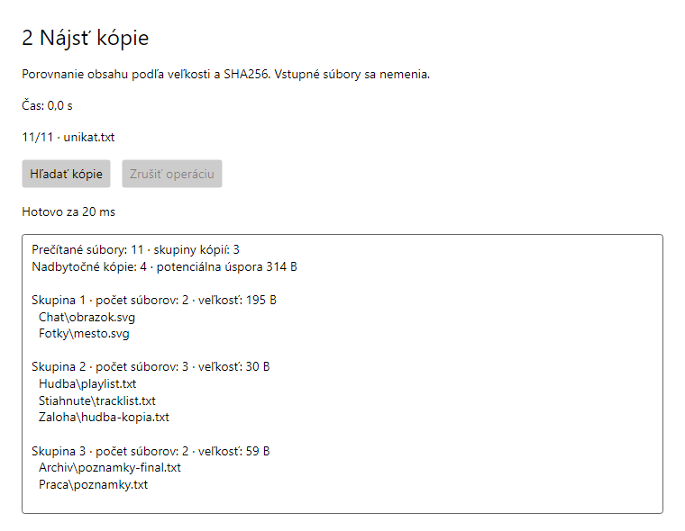
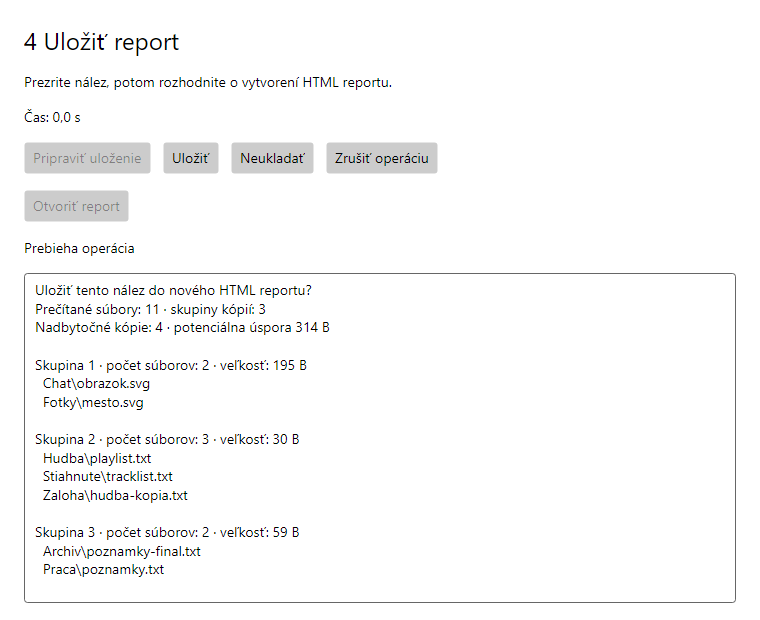
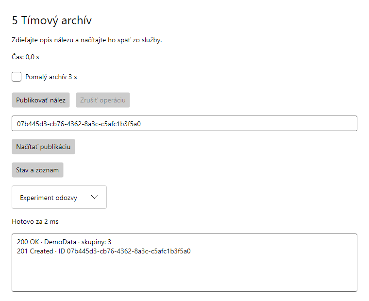

# Laboratórne cvičenie 5

Audit súborov a zdieľanie reportov

Vytvoríte nástroj na vyhľadanie duplicitných súborov podľa obsahu, export HTML reportu a publikovanie výsledku cez vlastné REST API. Precvičíte rušenie CPU výpočtu, prepojené tokeny a externé dokončenie Tasku.

## Príprava pre všetky systémy

Rozbaľte celý Starter ZIP. Potrebujete .NET 10 SDK pre architektúru počítača; na Macu s Apple Silicon použite ARM64. V priečinku s FileDetective.slnx overte SDK a pripravte balíky ešte pred hodinou:

```text
dotnet --version
dotnet restore FileDetective.slnx
dotnet build FileDetective.slnx
```

Verzia SDK má začínať 10. Aplikácia používa Avalonia a rovnaké projekty na Windows, macOS aj Linuxe. Na Linuxe potrebuje grafické prostredie s X11 alebo XWayland a natívne knižnice uvedené v NAPOVEDA.md.

## Windows a Visual Studio 2026

Odporúčané prostredie na Windows je Visual Studio 2026 s podporou C# a ASP.NET. Otvorte FileDetective.slnx. V Solution Explorer kliknite pravým tlačidlom na riešenie → Configure Startup Projects alebo Properties → Startup Project → Multiple startup projects. Nastavte:

| Projekt | Akcia | Účel |
|---|---|---|
| FileDetective.Server | Start | REST archív na porte 5085 |
| FileDetective.Desktop | Start | Okno aplikácie |
| Core a Tests | None | Knižnica a testy |

Server presuňte nad Desktop a použite F5 alebo Ctrl+F5. Ak sa ponúka dodaný profil Audit - server a okno, môžete ho vybrať priamo. Testy spustíte cez Test → Test Explorer → Run All.

## Windows, macOS a Linux vo VS Code

Otvorte celý priečinok s FileDetective.slnx a nainštalujte C# Dev Kit. V Run and Debug vyberte Audit - server a okno a spustite ho cez F5 alebo tlačidlo Start Debugging. Dodané .vscode/launch.json a tasks.json zabezpečia build a oba procesy. Testy nájdete v Testing; Stop ukončí obe aplikácie.

## Spustenie cez terminály na všetkých systémoch

V dvoch termináloch z priečinka so solution spustite po jednom príkaze. Prvý terminál ponechajte obsadený serverom:

```text
dotnet run --project FileDetective.Server
dotnet run --project FileDetective.Desktop
```

**Kontrola:** Server vypíše Now listening on: http://127.0.0.1:5085. V aplikácii otvorte 5 Tímový archív → Stav a zoznam; táto kontrola funguje aj v starteri. Po zmene kódu zastavte príslušnú aplikáciu a spustite ju znova. Server v termináli ukončíte cez Ctrl+C; na porte 5085 spúšťajte iba jednu kópiu.

**Plán hodiny:** 100 minút vrátane pokusov. Pracujte vlastným tempom, bez odovzdávania a bodovania. Pri použití AI pred pokusom predpovedzte výsledok, prezrite zmeny a vysvetlite ich dôsledok.

<!-- page -->
## U1 Prehliadka prípadu je pripravená

Starter sa zostaví; prejde 10/28 testov. Zvyšných 18 zatiaľ zlyháva na nedoplnených TODO. Dodané testy neupravujte.

V okne 1 Preskúmať súbory načítajte oba plan.txt. Majú rovnaký názov aj veľkosť. Majú rovnaký obsah? Predpovedzte, ktoré ďalšie súbory v DemoData tvoria kópie.

Čítačka, asynchrónne I/O a obsluha tlačidla sú hotové. Z Lab04 už poznáte await, HTTP, zápis súborov a základný token. Tieto implementácie tu neopakujete. Nové úlohy začínajú vlastným CPU výpočtom v U2.

## U2 Nájdite skryté kópie

**Upravte:** FileDetective.Core/Fingerprint.cs, TODO U2a, a DuplicateScanner.cs, HashFileAsync.

- V každom bloku pripravenej CPU slučky overte token cez ThrowIfCancellationRequested.
- Najprv await reader.ReadAsync(path, token), potom await Task.Run pre Fingerprint.Compute(bytes, token). Token odovzdajte aj plánovaniu.
- Vráťte FingerprintEntry(path, bytes.LongLength, hash). Použite celý obsah súboru.

**Vyskúšajte:** V okne 2 Nájsť kópie očakávajte 3 skupiny a 4 nadbytočné kópie. Oba plan.txt medzi nimi nepatria. Pre väčší pokus môžete v hlavnom okne tlačidlom Pripraviť väčší prípad 128 MiB vytvoriť väčšie dáta a sken počas práce zrušiť. K ukážkovým dátam sa vrátite tlačidlom Ukážkové súbory.

**Overte:** dotnet test FileDetective.slnx --filter "FullyQualifiedName~U2". Očakávaný stav: 17/28 testov celého riešenia. Prečo token iba na Task.Run nezastaví už bežiacu slučku? Prečo samotné async nepresunie hashovanie mimo UI vlákna?



**Pripravené časti:** SHA256, prechádzanie priečinka, zoskupenie, okná a automatické testy. Pri nejasnostiach použite samostatnú NAPOVEDA.md. Dodané testy nemeňte.

<!-- page -->
## U3 Prepojte používateľa a časový rozpočet

**Upravte:** FileDetective.Core/BudgetScanner.cs, RunAsync.

- Pridajte async a prepojený CancellationTokenSource z userToken a deadlineToken (časový limit). Zdroj musí žiť až do skončenia await.
- Overte linked token pred spustením a dočkajte scanner.ScanAsync s týmto tokenom.
- Používateľské zrušenie propagujte ako OperationCanceledException s userToken.
- Deadline preložte na TimeoutException. Pri oboch aktívnych signáloch má používateľ prednosť; ostatné chyby zachovajte.

**Vyskúšajte:** V okne 3 Audit s časovým limitom porovnajte 5000 ms, 1 ms na väčšom prípade a ručné Zrušiť operáciu. Rozlíšte Hotovo, Časový limit auditu a Zrušené používateľom. Malý priečinok môže skončiť ešte pred limitom.

**Overte:** Filter FullyQualifiedName~U3; celkovo 21/28 testov. Posledný dokončený nález sa pri zrušení nesmie nahradiť. Toto rozvíja príklad 3 z notebooku k prednáške: dve nezávislé príčiny zrušenia jednej operácie.

## U4 Počkajte na rozhodnutie o reporte

**Upravte:** FileDetective.Core/ExportDecision.cs, WaitAsync a TryDecide.

- WaitAsync je async Task<bool>. Pripravený TaskCompletionSource (TCS) zrušte registráciou tokenu cez TrySetCanceled(token).
- Registrácia musí žiť cez await _completion.Task; vráťte rozhodnutie.
- TryDecide(save) vráti TrySetResult(save). Prvý signál vyhrá, opakovaný vráti false.

**Vyskúšajte:** V okne 4 Uložiť report kliknite Pripraviť uloženie. Najprv zvoľte Neukladať, potom v novom pokuse Uložiť a Otvoriť report. Ďalšie čakanie ukončite zatvorením dialógu.

**Overte:** Filter FullyQualifiedName~U4; celkovo 25/28 testov. Čo sa pokazí pri predčasnom uvoľnení registrácie? Z príkladu 9 notebooku k prednáške používate externé dokončenie Tasku; tu rozhoduje obsluha, nie pomocný časovač.



<!-- page -->
## U5 Zdieľajte nález cez Minimal API

**Doplňte dve krátke miesta:**

- FileDetective.Core/ArchiveClient.cs, PublishAsync: pridajte async, await PostAsJsonAsync s ReportUpload.From(report) a tokenom. Overte HTTP stav a dočkajte ReadFromJsonAsync<ArchivedReport> s tokenom. Prázdnu odpoveď (null) nevracajte, vyhoďte výnimku, napríklad ?? throw new InvalidDataException(...); projekt berie varovania ako chyby. Pomalý režim používa api/reports?delayMs=3000, bežný api/reports.
- FileDetective.Server/ArchiveEndpoints.cs, SaveValidAsync: pridajte async, dočkajte store.SaveAsync(report, delayMs, token) a vráťte Results.Created s cestou /api/reports/{id} a uloženým objektom. Validácia a GET endpointy sú hotové.

**Vyskúšajte v 5 Tímový archív:**

- Okno vypíše skutočný stav odpovede servera. Publikovať nález má ukázať 201 Created, ID a Location /api/reports/{id}. Načítať publikáciu vráti 200 OK. Neexistujúce platné ID skončí 404.
- Zapnite Pomalý archív 3 s. Po ARCHIVE_STARTED na serveri kliknite Zrušiť operáciu. Očakávajte ARCHIVE_CANCELLED a žiadnu novú publikáciu.
- Overte token v celom reťazci: tlačidlo → HttpClient → RequestAborted endpointu → oneskorenie a zápis. Zrušenie po dokončenom zápise už uložený report nevráti späť.

**Overte:** Použite filter FullyQualifiedName~U5. Testy overujú iba klienta U5a s náhradným serverom; endpoint U5b overíte skutočnou požiadavkou v okne 5. Po U5 má prejsť všetkých 28 testov riešenia. Novinkou oproti Lab04 je vlastný POST endpoint, odpoveď 201 a rušenie práce na serveri.



**Nový krátky experiment z príkladu 10 notebooku k prednáške:** V hotovom ListAsync nájdite await foreach, yield return a EnumeratorCancellation. Spustite Stav a zoznam. Vysvetlite, kde sa čaká na dáta a kde sa sprístupní položka.

<!-- page -->
## Overte vlastný prípad

Vytvorte kópiu DemoData a otvorte ju cez Vlastný priečinok. Pred každou zmenou predpovedzte výsledok a potom zopakujte audit.

- Premenujte obrazok.svg: počet skupín sa nezmení.
- Zmeňte jeden znak v Praca/poznamky.txt: zostanú 2 skupiny a 3 nadbytočné kópie.
- Pridajte vlastný súbor aj jeho premenovanú kópiu. Nástroj ich má zaradiť spolu.
- Vytvorte nový report a publikujte nový nález.

**Skúste odhaliť chybu:** Uložte funkčný stav. Dočasne v HashFileAsync hashujte iba prvých 65536 bajtov, napríklad bytes.Take(Fingerprint.ChunkSize).ToArray(). Test U2b_Zmena_za_prvym_blokom_sa_nestrati musí zlyhať. Potom obnovte správny kód a test zopakujte.

## Rozlišujte tri výsledky

| Výsledok | Čo pozorujete | Čo musí zostať správne |
|---|---|---|
| Úspech | Platný nález alebo ID publikácie | Výsledok bol dočkaný |
| Zrušenie | Zrušené používateľom | Nepoužije sa prázdny úspech |
| Chyba | Napríklad HTTP 404 alebo nedostupný server | Okno dovolí ďalší pokus |

**Záverečná kontrola:** Zrušte bežiaci výpočet, vyvolajte timeout a zrušte pomalú HTTP požiadavku po jej začatí na serveri. Pri každom pokuse ukážte, ktorý token operáciu ukončil. Nakoniec spustite dotnet test FileDetective.slnx; referenčný výsledok je 28 úspešných prípadov.

## Kritériá porozumenia

Bez čítania vzoru vysvetlite, prečo token Task.Run nezastaví bežiacu slučku, prečo linked zdroj a registrácia musia žiť cez await, ktorý signál dokončil TCS a kde server pozoroval zrušenie. Samotné úspešné testy tieto vysvetlenia nenahrádzajú.

## Nadväznosť na Lab04

Znova neimplementujete cache, SemaphoreSlim, sťahovanie viacerých súborov, zápis balíčka ani porovnávanie postupného a súbežného downloadera. Pripravené WhenAll v archíve a pokus s blokovaním sú iba voliteľné pripomenutie; nie sú ďalšími povinnými úlohami.

Nové jadro tvorí rušenie vlastnej CPU slučky, prepojenie tokenov, registrácia a životnosť TCS, asynchrónny stream a RequestAborted na serveri.

**Dobrovoľne:** V OwnTests.cs pridajte prípad dvoch prázdnych súborov. Hotový stream môžete preskúmať podľa príkladu 10 notebooku k prednáške. Ďalšie vzory nájdete v NAPOVEDA.md.
