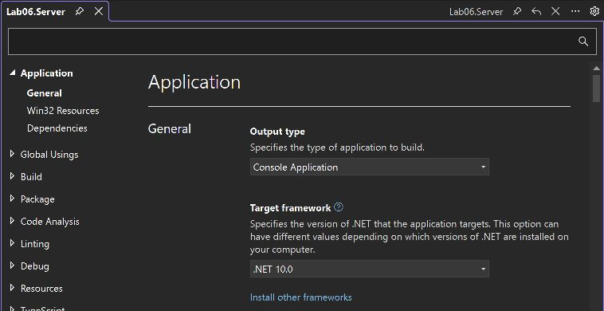
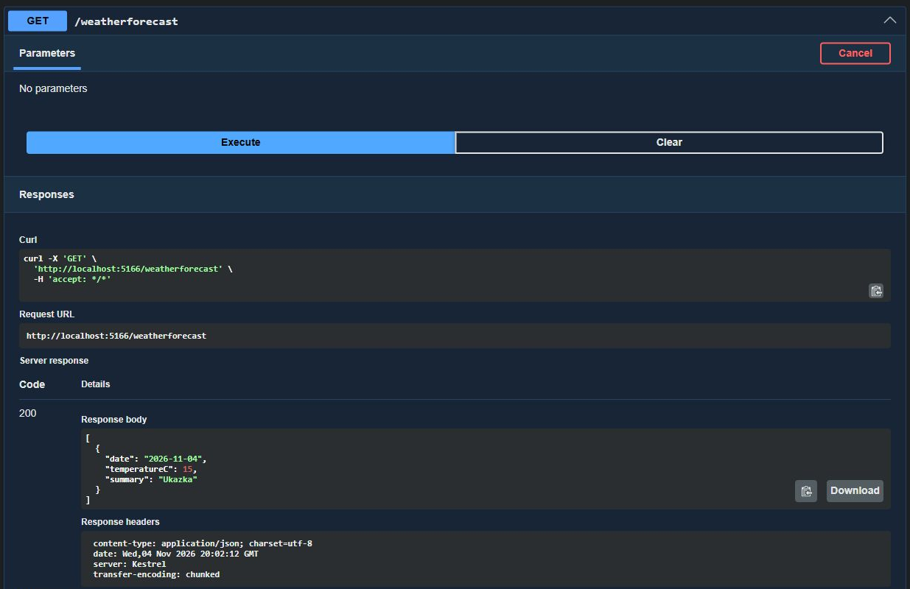
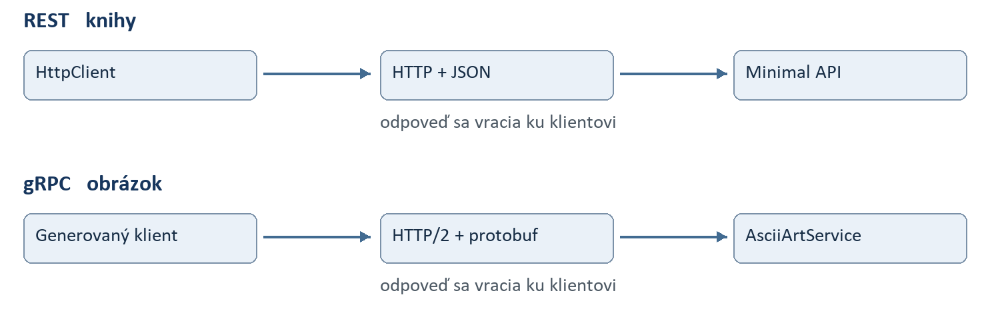

# Laboratórne cvičenie 6

REST API a gRPC

## O čo ide

Vytvoríte dve sieťové rozhrania. Cez REST budete spravovať knihy a skúmať HTTP požiadavky, odpovede a validáciu. Cez gRPC odošlete obrázok na server a získate jeho podobu zostavenú z textových znakov. Výsledok zobrazíte v konzole a uložíte do súboru.

Precvičíte si návrh kontraktu služby, prenos JSON a binárnych dát, generovanie gRPC tried a spracovanie chybových vstupov. Na vedomosti z predchádzajúcich cvičení nadviažete použitím await, CancellationToken a časového limitu vzdialeného volania.

**Pracujte vlastným tempom.** Orientačný plán je 100 minút po príprave projektov a balíkov. Čas je odhad. Riešenie ani odpovede neodovzdávate. AI, Copilot a internet môžete používať. Pred pokusom predpovedzte výsledok, prezrite zmeny v kóde a vysvetlite, čo sa po spustení stalo.

## Ako je riešenie usporiadané

| Projekt | Obsah | Úlohy |
| --- | --- | --- |
| Lab06.Server | Minimal API, pamäťové knihy a gRPC služba | U1 až U5 |
| Lab06.Client | Konzolový HTTP a gRPC klient | U3 až U5 |
| Lab06.GrpcContracts | Jeden spoločný .proto kontrakt a generované triedy | U4 |

Pomocné súbory BookHelper.cs a ImageToAscii.cs sú v priečinku Podklady štartovacieho balíka (pôvodne C06-kody.zip). Prvý z nich treba pred použitím upraviť podľa U1. Algoritmus prevodu obrázka je dodaný; vašou úlohou je sprístupniť ho cez službu.

## Plán práce

| Blok | Čas | Výsledok |
| --- | --- | --- |
| Štart a prehliadka | 10 min | Server beží a odpovedá na HTTP |
| U1 Knihy a validácia | 25 min | GET, POST a chybové odpovede |
| U2 Zmena a zmazanie | 10 min | PUT, DELETE a opakovanie operácií |
| U3 Kontrakt a klient | 10 min | OpenAPI a volanie cez HttpClient |
| U4 Obrázok cez gRPC | 25 min | ASCII text získaný zo servera |
| U5 Chyba a časový limit | 10 min | InvalidArgument a DeadlineExceeded |
| Rezerva | 10 min | Ladenie a vlastný experiment |

**Postup pri každej úlohe:** prečítajte kontrakt, nájdite alebo vytvorte uvedený súbor, doplňte kód, spustite pokusy a porovnajte výsledok s očakávaním. Pri zaseknutí použite uvedený vzor alebo požiadajte AI o vysvetlenie konkrétneho rozdielu.

**Cesta hodinou:** príprava → U1 až U3 REST → U4 a U5 gRPC → vlastná kontrola. Z návodov pre editory si vyberte iba svoj. Zakladanie od nuly je alternatíva k starteru. AI prompty používajte priebežne; Teplomer je voliteľný bonus po zvládnutí základu.

<!-- page -->
## Príprava projektov a spustenie

**Jedno riešenie, tri projekty, dva procesy.** Lab06.slnx združuje projekty. Server prijíma požiadavky a Client ich odosiela; oba spúšťate samostatne. GrpcContracts je knižnica spoločného gRPC kontraktu, preto nemá vlastný port ani spustenie. Pri U1 až U3 sa venujte iba Server a Client. Knižnicu začnete dopĺňať v U4.

Prípravu urobte pred hlavnou časťou hodiny. Potrebujete .NET 10 SDK a jedno prostredie: Visual Studio 2026 s podporou ASP.NET alebo VS Code s rozšírením C# Dev Kit od Microsoftu. Rozbaľte POT_Lab06_Starter_NET10.zip a otvorte Lab06.slnx. Spustite dotnet build Lab06.slnx. Čistý starter obsahuje tieto projekty pre .NET 10; pri vlastnom zakladaní zvoľte uvedené šablóny:

- Lab06.Server: ASP.NET Core Web API, vypnite Use controllers, zapnite HTTPS a OpenAPI.
- Lab06.Client: Console App.
- Lab06.GrpcContracts: Class Library. Odstráňte Class1.cs.

Projektové referencie na GrpcContracts, OpenAPI, Swagger UI a profil https sú v starteri pripravené. Knihy a gRPC doplníte počas cvičenia. Server aj klient musia mať projektovú referenciu na GrpcContracts. Každý .csproj obsahuje vlastné TargetFramework net10.0, Nullable a ImplicitUsings. Nastavenia sú priamo pri projekte, rovnako ako v bežných šablónach dotnet new.

**NuGet balíky:** OpenAPI a Swagger UI už starter obsahuje. Ostatné balíky pridajte pred U4.  Server potrebuje Grpc.AspNetCore, SixLabors.ImageSharp a Swashbuckle.AspNetCore.SwaggerUI. Ponechajte Microsoft.AspNetCore.OpenApi zo šablóny. Client potrebuje Grpc.Net.Client. GrpcContracts potrebuje Google.Protobuf, Grpc.Core.Api a Grpc.Tools; pri Grpc.Tools nastavte PrivateAssets na all. Použite vzájomne kompatibilné stabilné verzie a obnovte balíky ešte pred hodinou.

V Server/Program.cs ponechajte konfiguráciu šablóny a doplňte registrácie pred builder.Build():

```csharp
builder.Services.AddValidation();
builder.Services.AddGrpc(); // az po pridani balicka pri U4
// AddOpenApi() je už v šablóne; nepridávajte ho druhýkrát.
```

V starteri je nasledujúce UI už zapojené. Pri vlastnom zakladaní ho pridajte do existujúceho bloku IsDevelopment() k MapOpenApi():

```csharp
app.UseSwaggerUI(options =>
    options.SwaggerEndpoint("/openapi/v1.json", "Lab06"));
```

**Spustenie:** najskôr spustite Server s profilom https. Z konzoly si zapíšte skutočnú HTTPS adresu; tú istú použite v klientovi. V prehliadači otvorte /swagger a vyskúšajte /weatherforecast. Overte aj /openapi/v1.json. Následne spúšťajte Client samostatne. Po úprave server zastavte a znova spustite.

Pri probléme s lokálnym certifikátom použite v termináli `dotnet dev-certs https --trust` a potvrďte dôveru vývojovému certifikátu. Nevypínajte kontrolu certifikátov v klientskom kóde. gRPC potrebuje HTTP/2; zmena adresy z https na http sama osebe problém nerieši.

**Krátka prehliadka:** nájdite handler weatherforecast. Porovnajte ho s controllerom v C06, strany 13 až 17. Určte, kde sa definuje cesta, vstup a návratová hodnota. Celý druhý server s controllermi netreba vytvárať.

<!-- page -->
## Visual Studio 2026 a živé OpenAPI

**Odporúčaná cesta:** rozbaľte starter a otvorte Lab06.slnx. Nevytvárajte nové projekty v jeho vnútri. V Solution Explorer vyberte Lab06.Server, otvorte Properties a skontrolujte Target framework .NET 10.0. Hodnota je zapísaná priamo v Lab06.Server.csproj.



Pravým tlačidlom na Lab06.Server vyberte Set as Startup Project, zvoľte profil https a spustite Ctrl+F5. Klienta spustite samostatne cez Debug → Start New Instance na jeho projekte alebo príkazom uvedeným na ďalšej strane. Server musí zostať bežať.



**Vyskúšajte:** otvorte /swagger, rozbaľte GET /weatherforecast, kliknite Try it out a Execute. Rozlíšte skutočnú Server response od vygenerovaného Example Value. Screenshot používa samostatný lokálny HTTP port 5166 na zachytenie REST odpovede; pri práci používajte HTTPS adresu svojho servera, v starteri https://localhost:7066. Pri U1 pribudnú /api/books.

<!-- page -->
## VS Code otvorenie a prvé spustenie

**Čo vytvoriť:** pri použití ZIP nič nezakladajte. Rozbaľte ho do vlastného pracovného priečinka a cez File → Open Folder otvorte koreň, v ktorom leží Lab06.slnx. Samotné otvorenie Program.cs nestačí na pohodlnú prácu s celým riešením. Cestu od nuly nájdete na ďalšej strane; vyberte si iba jednu cestu.

**Príprava:** nainštalujte .NET 10 SDK a vo VS Code rozšírenie C# Dev Kit od Microsoftu. Ak sa zobrazuje Restricted Mode, najprv skontrolujte pôvod a obsah priečinka; dôveru vlastnému overenému projektu potvrdzuje používateľ. Na AI nepotrebujete konkrétny nástroj; stačí editor a prípadne samostatný chat.

V Explorer rozbaľte Lab06.Server a otvorte Lab06.Server.csproj. Na začiatku súboru nájdete tieto nastavenia; ďalšiu časť s balíkmi a projektovou referenciou ponechajte. Rovnaký PropertyGroup nájdete aj v ostatných projektoch, klient navyše obsahuje OutputType Exe.

```xml
<PropertyGroup>
  <TargetFramework>net10.0</TargetFramework>
  <Nullable>enable</Nullable>
  <ImplicitUsings>enable</ImplicitUsings>
</PropertyGroup>
```

V Terminal → New Terminal otvorte terminál v koreni riešenia a vykonajte:

```powershell
dotnet --version
dotnet restore Lab06.slnx
dotnet build Lab06.slnx
dotnet run --project Lab06.Server --launch-profile https
```

Prvý príkaz má ukázať SDK 10.0.x. Restore pripraví NuGet závislosti, build skontroluje preklad. Po spustení čakajte na Now listening on a otvorte https://localhost:7066/swagger. Prvý terminál nechajte bežať. Cez tlačidlo + vytvorte druhý terminál v tom istom koreni:

```powershell
dotnet run --project Lab06.Client
```

**Kontrolný bod:** čistý klient zatiaľ vypíše iba pripravenosť; knihy ani ASCII ešte nevolá. Ak server beží, weatherforecast odpovie 200. Po zmene súboru uložte Ctrl+S, server zastavte Ctrl+C a spustite znova. Pri obsadenom porte skontrolujte, či už server nebeží v inom termináli alebo vo Visual Studiu.

**Ladenie:** po načítaní riešenia C# Dev Kit nastavte breakpoint kliknutím vedľa čísla riadka handlera. V Run and Debug vyberte .NET a projekt Lab06.Server s profilom https (alebo Debug → Start New Instance v Solution Explorer). Server nespúšťajte súčasne cez terminál aj debugger. Odošlite požiadavku, sledujte Locals a krokovanie F10; F5 pokračuje. Pri automatickom odmietnutí vstupu 400 sa handler nemusí vôbec vykonať.

<!-- page -->
## VS Code vytvorenie riešenia od nuly

Toto je alternatíva k ZIP pre študentov, ktorí si chcú precvičiť zakladanie projektov. V prázdnom pracovnom priečinku otvorte terminál. Príkazy sú pre .NET 10 SDK; v tejto verzii vzniká štandardne súbor .slnx.

```powershell
mkdir Lab06
cd Lab06
dotnet new sln -n Lab06
dotnet new webapi -n Lab06.Server -f net10.0
dotnet new console -n Lab06.Client -f net10.0
dotnet new classlib -n Lab06.GrpcContracts -f net10.0
dotnet sln add Lab06.Server Lab06.Client Lab06.GrpcContracts
dotnet add Lab06.Server reference Lab06.GrpcContracts
dotnet add Lab06.Client reference Lab06.GrpcContracts
dotnet add Lab06.Server package Swashbuckle.AspNetCore.SwaggerUI
code .
```

Šablóna webapi bez prepínača --use-controllers vytvorí Minimal API. Odstráňte nepoužívaný Class1.cs z GrpcContracts. Ak príkaz code nie je dostupný, otvorte priečinok cez File → Open Folder. OpenAPI ponechajte zo šablóny a Swagger UI zapojte podľa časti Príprava projektov. Pomocné súbory vezmite z Podklady v ZIP.

Pri vlastnom projekte môže šablóna prideliť iné porty. V Lab06.Server/Properties/launchSettings.json nájdite profil https a applicationUrl; v klientovi nastavte rovnakú HTTPS adresu. Alternatívne skopírujte pripravený profil zo startera. TargetFramework je v jednotlivých .csproj, rovnako ako v pripravenom starteri.

### Balíky pred gRPC časťou

Nasledujúce príkazy sú rovnaké pre obe prostredia aj obe cesty. Spúšťajte ich v koreni riešenia, keď je server zastavený:

```powershell
dotnet add Lab06.Server package Grpc.AspNetCore
dotnet add Lab06.Server package SixLabors.ImageSharp
dotnet add Lab06.Client package Grpc.Net.Client
dotnet add Lab06.GrpcContracts package Google.Protobuf
dotnet add Lab06.GrpcContracts package Grpc.Core.Api
dotnet add Lab06.GrpcContracts package Grpc.Tools
dotnet build Lab06.slnx
```

V Lab06.GrpcContracts.csproj skontrolujte pri Grpc.Tools hodnotu PrivateAssets="all". Konkrétne verzie zapisuje CLI do .csproj; pred hodinou overte restore a build na školskom počítači. Po pridaní .proto a položky Protobuf z U4 zopakujte build, aby vznikli generované typy. GrpcContracts sa nespúšťa samostatne.

**Ako ďalej vo VS Code:** U1 a U2 upravujte v Server, U3 v Client a U4 v každom z troch projektov. Explorer → New File vytvorí nový súbor v zvolenom priečinku. Ctrl+Shift+M zobrazí Problems, F12 prejde na definíciu. Najprv opravte prvú chybu prekladu; ostatné môžu byť jej dôsledkom.

<!-- page -->
## Čo sa pri vzdialenom volaní deje

Metóda v klientovi nepracuje priamo s pamäťou servera. Vstup sa serializuje, odošle po sieti, server ho spracuje a odpoveď sa deserializuje. Aj správny kód preto potrebuje riešiť nedostupnosť, neplatné dáta a časový limit.



| Otázka | REST v tomto labe | gRPC v tomto labe |
| --- | --- | --- |
| Čo klient volá | Metódu HTTP a URL zdroja | Metódu služby z .proto |
| Čím opisujeme rozhranie | OpenAPI dokument | .proto kontrakt |
| Ako prenášame telo | JSON | Binárne protobuf správy |
| Ako čítame chybu | HTTP stav a chybové telo | RpcException a gRPC StatusCode |
| Ako skúšame volanie | Swagger UI a HttpClient | Generovaný konzolový klient |

**OpenAPI nie je Swagger UI.** /openapi/v1.json je strojovo čitateľný opis HTTP rozhrania. /swagger je stránka, ktorá tento opis načíta a umožní poslať požiadavku. Zobrazenie schémy samo nevynucuje pravidlá na serveri. gRPC služba sa automaticky neobjaví v tomto Swagger UI; jej kontrakt testujete gRPC klientom.

**Kontrakt nie je implementácia.** DTO a .proto určujú tvar správ, handler alebo služba určujú správanie. Vygenerovaná metóda vyzerá ako lokálne volanie, stále však komunikuje so vzdialeným procesom. await uvoľní čakanie volajúceho; neurýchli samotný prevod obrázka.

**Chyba má niekoľko vrstiev.** Text namiesto Guid môže zlyhať pri bindingu ešte pred handlerom. Platný, ale neexistujúci Guid vedie na 404 v handleri. Chýbajúci rok má zachytiť validácia s 400. Vypnutý server klient hlási ako transportnú chybu. Pri každom pokuse určte, ktorá vrstva rozhodla.

**Bez predčasných záverov o výkone:** REST môže tiež používať HTTP/2 a gRPC nie je automaticky najrýchlejšie pre každú úlohu. V tomto cvičení porovnávate návrh kontraktu a obsluhu chýb. Jedno meranie zahŕňa aj štart, nadviazanie spojenia a výpis do konzoly; nestačí na všeobecné porovnanie výkonu.

<!-- page -->
## U1 Knihy a validácia

**Cieľ:** Server vráti knihy, rozlíši neexistujúcu knihu a odmietne neplatný vstup bez pádu.

**Kde:** Server/Books/BookHelper.cs a Server/Program.cs. Skopírujte BookHelper.cs z C06-kody.zip, pridajte jeho namespace do Program.cs. Typy Book, CreateBookDto a UpdateBookDto označte public.

**Pripravte úložisko:** metódy InMemoryBooks pracujú so spoločným List. Chráňte všetky čítania aj zápisy rovnakým zámkom; Query musí vytvoriť pole ToArray() ešte pod zámkom. Zaregistrujte jednu inštanciu cez AddSingleton<InMemoryBooks>(). Ak má byť trieda parametrom verejnej metódy, označte aj ju public. Reštart servera obnoví počiatočné knihy.

Rok knihy musí byť povinný. Opravte DTO; rovnaké pravidlá neskôr použite pri úplnej aktualizácii:

```csharp
public class CreateBookDto
{
    [Required, MinLength(2)] public string? Title { get; set; }
    [Required, MinLength(2)] public string? Author { get; set; }
    [Required, Range(1450, 2100)] public int? Year { get; set; }
}
```

**Postup:** Pred app.Run() doplňte GET /api/books, GET /api/books/{id} a POST /api/books. Zoznam vráti 200 a pole kníh. Detail vráti 200 alebo 404. POST vráti 201, vytvorenú knihu a Location na jej detail. Neplatný vstup má vrátiť 400 s chybami polí a nesmie zmeniť úložisko.

Vzor handlera detailu; pre Guid použite routu {id}, aby chybný formát skončil chybou bindingu 400:

```csharp
app.MapGet("/api/books/{id}", (Guid id, InMemoryBooks db) =>
    db.TryGet(id, out var book)
        ? Results.Ok(book) : Results.NotFound());
```

**Vyskúšajte:** cez Swagger UI pošlite knihu {"title":"Duna","author":"Frank Herbert","year":1965}. Zopakujte požiadavku bez year, s year null, s rokom 1449 a s jednopísmenovým názvom. Pred každým pokusom určte očakávaný stav.

**Overte:** správny POST vráti 201 a Location; GET na túto adresu vráti rovnaké ID. Štyri neplatné varianty vrátia 400 a nepribudnú v zozname. Platný neexistujúci Guid vráti 404.

**Zamyslite sa:** Prečo samotný Range nestačí na povinný rok? Čo robí operátor ! a čo nekontroluje? Kde sa vykonáva validácia, keď handler obsahuje iba uloženie?

<!-- page -->
## U2 Zmena a zmazanie knihy

**Cieľ:** HTTP metódy majú jednoznačný význam a opakovanie požiadavky má predvídateľný výsledok.

**Kde:** Server/Books/BookHelper.cs a Server/Program.cs.

**Postup:** V UpdateBookDto vyžadujte Title, Author aj Year rovnakými atribútmi ako pri vytváraní. V Update nahraďte všetky tri hodnoty, zachovajte ID. PUT /api/books/{id} aktualizuje iba existujúcu knihu: úspech vráti 204, neplatný vstup 400 a platné neexistujúce ID 404. DELETE /api/books/{id} vráti 204 pri zmazaní, inak 404.

**Vyskúšajte:** vytvorte knihu, zmeňte jej názov cez PUT a následne ju načítajte. Rovnaký PUT vykonajte znova. Potom knihu dvakrát zmažte. Pri 204 nečakajte JSON telo.

**Overte:** PUT s vynechaným autorom vráti 400. Dva platné rovnaké PUT zachovajú ID aj počet kníh. Prvý DELETE vráti 204, druhý 404; následný GET vráti 404.

**Zamyslite sa:** Prečo môže byť DELETE idempotentný, aj keď jeho druhá odpoveď má iný stav? Ako by ste pomenovali operáciu, ktorá mení iba poslané polia?

### Prehľad odpovedí knižného API

| Operácia | Úspech | Neúspešný pokus |
| --- | --- | --- |
| GET zoznamu alebo detailu | 200 a JSON | Detail neexistuje: 404 |
| POST novej knihy | 201, JSON a Location | Chýbajúci rok: 400 |
| PUT existujúcej knihy | 204 bez tela | Chýbajúci autor: 400; ID neexistuje: 404 |
| DELETE knihy | 204 bez tela | Druhé zmazanie rovnakého ID: 404 |

**Pripravené pokusy:** v starteri nájdete REST-pokusy.http s požiadavkami a očakávanými stavmi. Spúšťajte ich postupne až po príslušnej úlohe. Po POST vložte skutočné ID do bookId. Ak váš editor .http súbory nespúšťa, použite rovnaké cesty a JSON telá v Swagger UI.

## U3 Kontrakt a HTTP klient

**Cieľ:** Prepojiť JSON požiadavku, handler, schému OpenAPI a odpoveď klienta.

**Kde:** metadáta endpointov v Server/Program.cs a Client/Program.cs. V klientovi vytvorte vlastný verejný BookDto s vlastnosťami Id, Title, Author a Year.

**Postup:** V OpenAPI nájdite schému knihy a CreateBookDto. Doplňte opis návratových typov a stavov cez Produces, ProducesValidationProblem alebo typované výsledky. V konzole vytvorte jeden HttpClient na celý beh, BaseAddress nastavte na adresu servera. Použite System.Net.Http.Json.

```csharp
using var response = await http.PostAsJsonAsync("/api/books",
    new { title = "Duna", author = "Frank Herbert", year = 1965 });
Console.WriteLine($"HTTP {(int)response.StatusCode}");
Console.WriteLine(response.Headers.Location);
Console.WriteLine(await response.Content.ReadAsStringAsync());
```

**Vyskúšajte a overte:** pri platnom vstupe získajte Location a načítajte knihu cez GetFromJsonAsync<BookDto>(). Pri neplatnom vstupe vypíšte stav a chybové telo; nepokúšajte sa chybu deserializovať ako knihu. Nedostupný server zachyťte ako HttpRequestException.

**Zamyslite sa:** Aký je rozdiel medzi jedným príkladom JSON a OpenAPI kontraktom? Zabezpečuje samotný opis odpovede 400 aj kontrolu vstupu?

<!-- page -->
## U4 Obrázok cez gRPC

**Pokračujete v tom istom riešení.** REST endpointy zostávajú v Server/Program.cs. Pridáte AsciiArtService a spoločný kontrakt; server bude na rovnakej HTTPS adrese obsluhovať REST aj gRPC. Nový serverový projekt nepotrebujete. Klient doplníte o druhý spôsob volania.

**Cieľ:** Odoslať binárny obrázok cez typovaný kontrakt a získať textový výsledok.

**Kde:** GrpcContracts/Protos/ascii.proto, Server/AsciiArtService.cs a Client/Program.cs. Do Server pridajte dodaný ImageToAscii.cs a jeho namespace.

V projekte GrpcContracts vytvorte nasledujúci kontrakt:

```protobuf
syntax = "proto3";
option csharp_namespace = "Lab06.Grpc";
package lab06;
service AsciiArt {
  rpc ConvertImageToAscii (ImageRequest) returns (AsciiArtResponse);
}
message ImageRequest { bytes image_data = 1; }
message AsciiArtResponse { string ascii_art = 1; }
```

Do ItemGroup v GrpcContracts.csproj pridajte a zostavte riešenie:

```xml
<Protobuf Include="Protos\ascii.proto" GrpcServices="Both" />
```

**Postup:** Cez F12 preskúmajte vygenerované typy. Both generuje bázu služby aj klienta; pri oddelenom generovaní možno použiť Server alebo Client. Generované súbory v obj neupravujte. V serveri vytvorte verejnú AsciiArtService odvodenú od AsciiArt.AsciiArtBase a prepíšte ConvertImageToAscii.

```csharp
var text = ImageToAscii.Convert(request.ImageData.ToByteArray());
return Task.FromResult(new AsciiArtResponse { AsciiArt = text });
```

## U4 Klient a výsledok prevodu

Službu zaregistrujte pred app.Run() pomocou app.MapGrpcService<AsciiArtService>(). Na klientovi použite namespace Lab06.Grpc, Google.Protobuf a Grpc.Net.Client:

```csharp
using var channel = GrpcChannel.ForAddress(serverUrl);
var client = new AsciiArt.AsciiArtClient(channel);
var bytes = await File.ReadAllBytesAsync(imagePath);
var reply = await client.ConvertImageToAsciiAsync(
    new ImageRequest { ImageData = ByteString.CopyFrom(bytes) });
Console.WriteLine(reply.AsciiArt);
await File.WriteAllTextAsync("vysledok.txt", reply.AsciiArt);
```

**Vyskúšajte a overte:** použite malý PNG alebo JPEG s nepriehľadným pozadím, pod 1 MiB. Nastavte imagePath na jeho skutočnú cestu. Dodaný prevodník vytvorí 40 riadkov po 80 znakov. Otvorte výsledok neproporcionálnym písmom. Zmeňte obrázok a porovnajte výsledok.

### Od súboru po výsledok

Client načíta súbor na byte[], ByteString ho vloží do ImageRequest a generovaný klient odošle správu. Server zavolá dodaný prevodník a odpovie textovým poľom AsciiArt. Až klient tento text vypíše a uloží. Súbor vysledok.txt vzniká v pracovnom priečinku klienta, nie na serveri.

**Čo sledujte pri ladení:** v klientovi počet bajtov, na serveri request.ImageData.Length a v odpovedi počet riadkov. Pri úspešnom volaní sa počty bajtov pred odoslaním a po prijatí zhodujú. Počet bajtov celého sieťového prenosu je väčší, pretože obsahuje aj rámcovanie a hlavičky.

**Vlastný experiment:** odošlite ten istý obrázok dvakrát. Potom server zastavte a zopakujte volanie. Vysvetlite rozdiel medzi rovnakým výpočtom a úspešným sieťovým prenosom. Do klienta nevkladajte samotný algoritmus prevodu; cieľom je použiť službu.

**Zamyslite sa:** Odkiaľ vznikla trieda klienta? Prečo sa bajty prenášajú cez ByteString? Číslo poľa je identifikátor v prenose; prečo ho nemožno ľubovoľne prečíslovať?

<!-- page -->
## U5 Chyba a časový limit

**Cieľ:** Klient rozlíši chybný vstup a prekročenie času; server spolupracuje pri zrušení.

**Kde:** Server/AsciiArtService.cs a Client/Program.cs. Použite namespace Grpc.Core.

**Postup:** Prázdne dáta odmietnite cez RpcException so stavom InvalidArgument. Rovnako preložte očakávané chyby dekódovania poškodeného alebo nepodporovaného obrázka. Ostatné chyby nepovažujte automaticky za chybu používateľa. Na klientovi zachyťte RpcException a vypíšte StatusCode a zrozumiteľný opis.

```csharp
if (request.ImageData.IsEmpty)
    throw new RpcException(new Status(StatusCode.InvalidArgument,
        "Obrázok nesmie byť prázdny."));
```

Pre časový pokus dočasne zmeňte metódu služby na async Task<AsciiArtResponse>. Pred prevod pridajte čakanie a po prevode vracajte priamo objekt odpovede:

```csharp
await Task.Delay(3000, context.CancellationToken);
```

Klientské volanie doplňte o argument deadline: DateTime.UtcNow.AddSeconds(1). Na serveri zaznamenajte začiatok a zrušenie čakania. Pri zachytení OperationCanceledException ju po zaznamenaní znovu vyhoďte. Potom skúste limit 5 sekúnd. Diagnostické čakanie po pokuse odstráňte.

**Vyskúšajte a overte:** prázdny vstup a textový súbor namiesto obrázka vedú na InvalidArgument. Pri trojsekundovom čakaní a sekundovom limite dostane klient DeadlineExceeded. Server zaznamená zrušenie a nezačne prevod. Pri päťsekundovom limite sa malý obrázok spracuje.

**Zamyslite sa:** Znamená timeout klienta automatické ukončenie ľubovoľného serverového kódu? Čo sa stane, ak do Task.Delay neodovzdáte token? gRPC stav odlišujte od HTTP stavov REST API.

## Keď sa nedarí

- **Server je nedostupný:** skontrolujte bežiaci proces, profil https a adresu vypísanú serverom. Port nekopírujte naslepo zo snímky.
- **Validácia nevracia 400:** skontrolujte AddValidation, verejné DTO v serverovom projekte a atribúty na skutočne použitom type.
- **Chýbajú gRPC triedy:** skontrolujte Grpc.Tools, položku Protobuf, projektové referencie a build GrpcContracts.
- **Obrázok zlyhá:** overte cestu, obsah, formát a veľkosť. Predvolený limit prijatej správy gRPC je 4 MB; pre cvičenie používajte menšie obrázky.

## Vlastná kontrola a rozšírenia

Viete ukázať 201 s Location, odmietnutie neplatnej knihy, úplný PUT, druhý DELETE s 404, úspešný ASCII prevod a časový limit? Pri každom výsledku vysvetlite, ktorá časť kódu zaň zodpovedá.

**Záverečný pokus bez nápovedy:** vysvetlite spolužiakovi jednu REST a jednu gRPC požiadavku. Pri každej ukážte vstup, kontrakt, serverový kód, odpoveď a jednu chybu. Potom predpovedzte, čo sa zmení po reštarte servera, a overte to. Cieľom je rozumieť správaniu vlastného riešenia, nie iba dosiahnuť úspešný build.

**Pre rýchlejších:** pridajte optional int32 width = 2 do kontraktu s predvolenou šírkou 80 pri neprítomnom poli; vygenerujte klienta z vlastného OpenAPI; alebo streamujte ASCII riadky zo servera. Pôvodné čísla polí nemeníte. Pri práci s AI žiadajte aj negatívny test a vysvetlenie, nielen hotový kód.


<!-- page -->
## AI ako pomocník pri implementácii a učení

Prompty môžete vložiť do AI chatu v editore alebo do samostatného nástroja. Pripojte iba súbory potrebné pre daný krok. Najprv si nechajte vysvetliť plán, potom skontrolujte navrhnuté zmeny a spustite vlastný pokus. V čistom starteri sú U1 až U5 zámerne nedokončené.

### Najprv pochopiť projekt

**Prompt:** „Pracujem na Lab06 v .NET 10. Pozri Lab06.slnx, oba Program.cs a tri csproj. Bez zmien kódu vysvetli rozdiel medzi riešením, projektom a bežiacim procesom, úlohu troch projektov a poradie spustenia. Prečo GrpcContracts nespúšťam a prečo môže jeden server obsluhovať REST aj gRPC? Potom mi polož tri otázky na overenie porozumenia a počkaj na moje odpovede.“

### Jeden malý implementačný krok

**Prompt pre U1:** „Použi zadanie U1 a priložený BookHelper.cs. Najprv navrhni minimálny plán zmien pre GET zoznamu, GET detailu a POST knihy. Použi Minimal API v .NET 10, AddValidation, verejné DTO, povinný rok 1450 až 2100 a jedno pamäťové úložisko so zámkom. POST má vrátiť 201 s Location, chybný vstup 400. Neimplementuj U2 až U5. Po odsúhlasení plánu ukáž úpravy po súboroch a vysvetli, prečo samotný Range nestačí.“

**Váš krok:** pred spustením určte výsledok POST bez roku. Prezrite rozdiely v súboroch, zostavte projekt a urobte štyri negatívne pokusy z U1. Ak AI upravila nesúvisiace časti, zmeny vráťte alebo vyžiadajte menší zásah.

### Kontrakt a generovanie gRPC

**Prompt pre U4:** „Mám spoločný GrpcContracts a kontrakt ascii.proto podľa U4. Skontroluj balíky, referencie a Protobuf s GrpcServices Both. Vysvetli, čo vzniká pri builde a čo píšem ručne. Potom navrhni iba kostru serverovej služby a ukáž bod volania ImageToAscii.Convert. Neupravuj generované obj súbory. Daj mi kontrolný zoznam pre prvé úspešné volanie klienta.“

### Diagnostika podľa dôkazov

**Prompt pri chybe:** „Očakávam [stav alebo výsledok], dostávam [presná chyba]. Prikladám dotnet --version, relevantný kód a výstup dotnet build alebo servera. Navrhni tri možné príčiny zoradené podľa pravdepodobnosti a jeden rozlišujúci pokus. Najprv vysvetli pokus; nevymieňaj celé riešenie a nevypínaj kontrolu certifikátov.“

### Učenie bez hotovej odpovede

**Prompt:** „Buď môj tútor k Lab06. Pýtaj sa po jednej otázke: rozdiel 400 a 404, význam Location, idempotentnosť DELETE, rozdiel OpenAPI a Swagger UI, čísla protobuf polí a deadline verzus CancellationToken. Počkaj na odpoveď, oprav iba chybnú časť a vyžiadaj krátky experiment v mojom kóde. Nedávaj mi odpovede dopredu.“

**Kontrola porozumenia:** zavrite odpoveď AI a vlastnými slovami opíšte cestu jednej požiadavky od klienta po odpoveď. Ukážte miesto validácie, vedľajší účinok a obsluhu chyby. Ak to neviete, žiadajte vysvetlenie konkrétneho riadka a nový príklad vstupu.

<!-- page -->
## Voliteľný príklad rovnaký prevod cez dve rozhrania

**Teplomer na 15 až 20 minút po U4:** pridajte do existujúceho servera prevod teploty z °C na °F. Cieľom je porovnať rovnakú operáciu cez REST a gRPC bez kníh a bez dekódovania obrázka. Tento blok nie je súčasťou základného 100 minútového plánu.

**Spoločné pravidlo:** platný vstup je konečné číslo aspoň −273,15 °C. Výpočet F = C × 9 / 5 + 32 vykonajte vo vlastnej spoločnej serverovej metóde. Oba adaptéry volajú túto metódu, aby sa pravidlá nerozišli. Neplatný vstup odmietnite pred výpočtom. V gRPC si výslovne overte aj double.IsFinite.

| Prípad | REST | gRPC |
| --- | --- | --- |
| Vstup | GET /api/temperature?celsius=20 | Temperature.Convert s celsius = 20 |
| Úspech | 200 a {"fahrenheit":68} | TemperatureReply s fahrenheit = 68 |
| Vstup −300 | 400 a opis chyby | InvalidArgument |
| Chýbajúca hodnota | 400 pri povinnom query parametri | InvalidArgument pri neprítomnom poli |

V GrpcContracts/Protos/temperature.proto založte samostatný kontrakt a pridajte ho do csproj rovnako ako ascii.proto:

```protobuf
syntax = "proto3";
option csharp_namespace = "Lab06.Grpc";
package lab06;
service Temperature {
  rpc Convert (TemperatureRequest) returns (TemperatureReply);
}
message TemperatureRequest { optional double celsius = 1; }
message TemperatureReply { double fahrenheit = 1; }
```

**Postup:** v REST použite povinný parameter double celsius. V gRPC skontrolujte HasCelsius, až potom hodnotu Celsius; bez optional by sa neprítomnosť čísla nedala rozlíšiť od nuly. Vytvorte TemperatureService, zaregistrujte MapGrpcService a z rovnakého klienta zavolajte obe rozhrania. Výsledky porovnávajte s toleranciou, napríklad 0,001, nie všeobecným očakávaním presnej rovnosti desatinných čísel.

**Overte:** 0 °C → 32 °F, 20 °C → 68 °F a −40 °C → −40 °F. Skúste −300, chýbajúcu hodnotu, query celsius=abc a gRPC double.NaN. Rozlíšte chybu bindingu od kontroly pravidla vo vašom kóde. NaN nie je bežná číselná hodnota JSON; v protobuf double ju môže klient poslať.

**Prompt:** „Pomôž mi doplniť voliteľný Teplomer do existujúceho Lab06. Najprv navrhni spoločnú validáciu a výpočet a dva tenké adaptéry. Implementuj po jednom rozhraní, zachovaj prítomnosť optional poľa a navrhni pokusy z tabuľky. Po každom kroku sa ma spýtaj, kde sa zmení správanie pri chýbajúcej hodnote.“

### Dokumentácia na ďalšie štúdium

- VS Code a C# Dev Kit: https://code.visualstudio.com/docs/csharp/get-started
- .NET 10 a formát slnx: https://learn.microsoft.com/dotnet/core/compatibility/sdk/10.0/dotnet-new-sln-slnx-default
- ASP.NET Core: https://learn.microsoft.com/aspnet/core/fundamentals/minimal-apis/overview?view=aspnetcore-10.0
- gRPC v ASP.NET Core: https://learn.microsoft.com/aspnet/core/grpc/?view=aspnetcore-10.0
